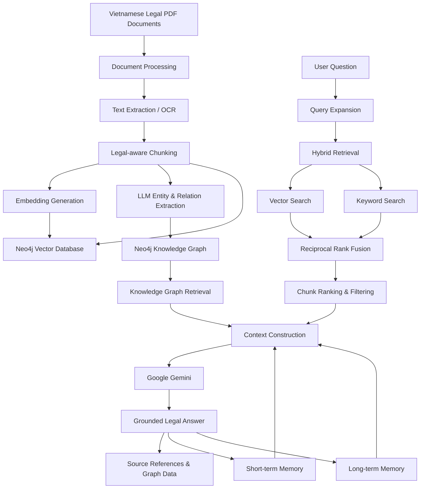
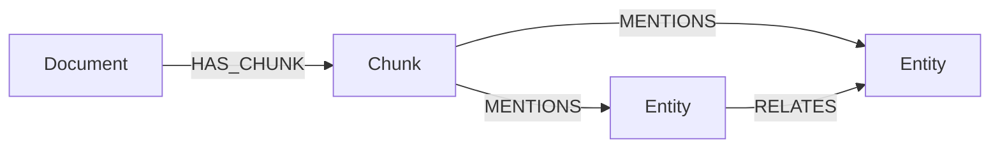

## Overview

**Legal GraphRAG** is an AI-powered Vietnamese legal assistant designed to help users search, understand, and explore Vietnamese legal documents through natural language conversations.

Unlike conventional vector-based RAG systems, this project combines **Hybrid Retrieval, Knowledge Graph reasoning, and conversational memory** to improve information retrieval, preserve legal context, and support more context-aware responses.

The system processes Vietnamese legal documents, extracts structured knowledge, stores document embeddings and entity relationships in Neo4j, and uses Google Gemini to generate context-grounded answers.

Users can also upload additional PDF documents through the web interface, allowing the knowledge base to be extended with new legal materials.

### Key Features

- **GraphRAG Architecture:** Combines vector retrieval with structured Knowledge Graph information.
- **Hybrid Search:** Integrates semantic vector search and keyword-based retrieval.
- **Query Expansion:** Rewrites user queries into alternative legal expressions to improve retrieval coverage.
- **Reciprocal Rank Fusion (RRF):** Merges multiple ranked retrieval results into a unified candidate list.
- **Knowledge Graph Extraction:** Extracts entities and relationships from Vietnamese legal documents using LLMs.
- **Two-Tier Conversational Memory:** Maintains short-term conversation context and persistent long-term memory.
- **Legal Document Processing:** Supports PDF extraction, scanned-document OCR, legal-aware chunking, and metadata extraction.
- **Source-aware Responses:** Provides document, page, and legal article references to support answer traceability.
- **Evaluation Pipeline:** Measures retrieval performance, semantic answer quality, relevance, and claim-level hallucination.

---

## System Architecture

The system consists of five major components:

1. Document Ingestion Pipeline
2. Knowledge Graph Construction
3. Hybrid GraphRAG Retrieval
4. LLM-based Answer Generation
5. Two-Tier Conversational Memory

### Architecture Diagram



---

## Technical Implementation

### 1. Document Ingestion Pipeline

The ingestion pipeline transforms unstructured Vietnamese legal documents into searchable and structured knowledge.

**Processing workflow:**

1. PDF text extraction using PyPDF.
2. Automatic detection of scanned pages.
3. OCR processing for scanned documents using Tesseract.
4. Text cleaning and normalization.
5. Legal-aware document chunking.
6. Extraction of legal metadata, including:
   - Articles (Điều)
   - Clauses (Khoản)
   - Chapters (Chương)
   - Sections (Mục)
7. Embedding generation using Google's Gemini embedding model.
8. Entity and relationship extraction using LLMs.
9. Storage of document chunks, embeddings, and graph relationships in Neo4j.

**Chunking strategy:**

The system uses `RecursiveCharacterTextSplitter` with legal-structure-aware separators.

| Parameter | Value |
|---|---:|
| Chunk size | 800 characters |
| Chunk overlap | 300 characters |
| Vector dimensions | 3072 |
| Similarity function | Cosine similarity |

The chunking strategy prioritizes legal document structures to preserve contextual relationships between articles, clauses, and paragraphs.

### 2. Knowledge Graph Construction

One of the main components of this project is the transformation of legal documents into a structured Knowledge Graph.

Instead of relying exclusively on document similarity, the system uses LLM-based information extraction to identify entities and their semantic relationships.

**Entity extraction workflow:**

- Extract meaningful entities from legal document chunks.
- Identify relationships between extracted entities.
- Normalize relationship types.
- Filter invalid or duplicated triplets.
- Store entities and relationships in Neo4j.

Example:

```text
Entity: Business
Relation: MUST_COMPLY_WITH
Entity: Food Safety Regulations
```

The graph represents relationships between legal concepts and allows the system to retrieve structured information beyond isolated text chunks.

**Neo4j graph schema:**



### 3. Hybrid GraphRAG Retrieval

The retrieval system combines semantic search, keyword matching, and Knowledge Graph information to improve the relevance of retrieved legal content.

**Retrieval workflow:**

**A. Query Expansion**

The original question is rewritten into up to two alternative legal expressions using an LLM.

This helps address vocabulary differences between everyday Vietnamese language and formal legal terminology.

**B. Hybrid Retrieval**

Two complementary retrieval strategies are implemented:

- **Vector Search:** Uses Gemini embeddings and Neo4j vector indexes to retrieve semantically similar document chunks.
- **Keyword Search:** Uses keyword matching to identify chunks containing relevant legal terminology.

**C. Reciprocal Rank Fusion (RRF)**

The retrieved candidate lists are merged using Reciprocal Rank Fusion.

\[
RRF(d)=\sum_{r\in R}\frac{1}{k+rank_r(d)}
\]

Where:

- \(d\): Retrieved document chunk.
- \(R\): Collection of ranked result lists.
- \(rank_r(d)\): Position of the chunk in a retrieval list.
- \(k\): Ranking constant (60).

**D. Ranking and Filtering**

Retrieved chunks undergo additional ranking based on semantic relevance and query-term matching.

**E. Context Construction**

The final context includes:

- Relevant document content.
- Original PDF filename.
- Page number.
- Article, clause, and chapter metadata.

This structured context is passed to the LLM for answer generation.

### 4. LLM-based Answer Generation

Google Gemini is used for both information extraction and natural language generation.

The answer generation component receives:

- The original user question.
- Retrieved legal document chunks.
- Relevant Knowledge Graph information.
- Short-term conversation history.
- Relevant long-term memories.

The model generates Vietnamese responses grounded in the retrieved context.

The implementation also includes model fallback candidates and retry handling for certain API failures.

### 5. Two-Tier Conversational Memory

To support multi-turn legal conversations, the system implements a two-tier memory architecture.

**Tier 1 – Short-term Memory (RAM)**

- Stores recent question-and-answer pairs.
- Maintains up to 30 conversation entries by default.
- Retrieves recent conversational context.
- Supports continuity across consecutive questions.
- Resets when the application restarts.

**Tier 2 – Long-term Memory (Neo4j)**

Contains two types of persistent memory:

**A. Conversation Memory**

- Stores previous question-and-answer pairs.
- Generates embeddings for semantic retrieval.
- Retrieves relevant historical conversations based on the current question.

**B. UserFact Memory**

- Uses an LLM to extract important facts from conversations.
- Stores extracted facts as structured memory nodes.
- Uses vector similarity to identify duplicate facts.
- Updates existing facts instead of creating unnecessary duplicates.

This architecture allows the assistant to combine recent conversational context with semantically relevant historical information.

---

## Technology Stack

| Category | Technologies |
|---|---|
| Programming Language | Python |
| Backend | Flask, Flask-CORS |
| LLM | Google Gemini |
| Embedding Model | Gemini Embedding |
| RAG Architecture | GraphRAG, Hybrid RAG |
| Vector Database | Neo4j Vector Index |
| Knowledge Graph | Neo4j, Cypher |
| Document Processing | PyPDF, PyMuPDF |
| Text Chunking | LangChain Text Splitters |
| OCR | Tesseract, PyTesseract, PDF2Image |
| Evaluation | BERTScore, XLM-RoBERTa-large, LLM-as-a-Judge |
| Frontend | HTML, CSS, JavaScript |

---

## Evaluation

The project includes an evaluation pipeline designed to measure retrieval quality, answer relevance, semantic similarity, and hallucination.

The evaluation dataset contains **70 Vietnamese legal questions across 7 legal domains**, with 10 questions per domain.

### 1. Retrieval Performance

| Metric | Result |
|---|---:|
| Precision@1 | 0.9857 |
| Precision@3 | 0.9429 |
| Precision@5 | 0.9343 |
| Mean Reciprocal Rank (MRR) | 0.9929 |

### 2. Answer Quality

| Metric | Result |
|---|---:|
| BERTScore F1 | 0.8865 |
| Answer Relevancy | 0.9615 |

BERTScore uses XLM-RoBERTa-large to measure semantic similarity between generated answers and reference answers.

### 3. Hallucination Evaluation

The system implements claim-level hallucination evaluation using an LLM-as-a-Judge approach.

The evaluator:

1. Extracts individual claims from generated answers.
2. Compares each claim against the retrieved legal document context.
3. Classifies claims as supported, unsupported, or general knowledge.
4. Calculates an overall grounding score.

**Evaluation results:**

| Verdict | Result |
|---|---:|
| PASS | 20.0% |
| PARTIAL | 42.9% |
| FAIL | 37.1% |

The results demonstrate that retrieval performance and answer relevance do not necessarily guarantee factual grounding.

Although the retrieval and semantic relevance metrics are promising, claim-level verification reveals opportunities to improve answer grounding and reduce unsupported legal statements.

The evaluation report is available in [`evaluation_report.md`](evaluation_report.md).

**Note:** These results are from the recorded evaluation run on June 14, 2026, using the project's 70-question dataset. They should not be interpreted as a general guarantee of legal accuracy.

---

## Project Structure

```text
legal_graphRAG/
│
├── app.py
│
├── config.py
├── requirements.txt
│
├── embedding.py
├── llm_functions.py
│
├── pdf_loader.py
├── ingest_service.py
│
├── neo4j_store.py
├── rag_service.py
├── memory_service.py
│
├── evaluate.py
├── evaluation_data.py
├── evaluation_report.md
├── evaluation_results.json
│
├── pdfs/
│   └── Legal PDF documents
│
├── static/
│   ├── css/
│   ├── js/
│   └── assets/
│
└── templates/
    └── index.html
```

---

## Installation and Setup

### Prerequisites

- Python 3.10 or later.
- Neo4j Database with vector index support.
- Google Gemini API key.
- Git.

### 1. Clone the Repository

```bash
git clone https://github.com/Otis-Mel/legal_graphRAG.git

cd legal_graphRAG
```

### 2. Create a Virtual Environment

```bash
python -m venv venv
```

Activate the environment:

**Windows:**

```bash
venv\Scripts\activate
```

**macOS / Linux:**

```bash
source venv/bin/activate
```

### 3. Install Dependencies

```bash
pip install -r requirements.txt
pip install google-genai
```

The additional Google Gen AI SDK is required by the current implementation's `google.genai` imports.

### 4. Configure Environment Variables

Create a `.env` file in the project root:

```env
GEMINI_API_KEY=your_gemini_api_key

NEO4J_URI=bolt://localhost:7687
NEO4J_USER=neo4j
NEO4J_PASSWORD=your_neo4j_password

PDF_DIR=pdfs

VECTOR_INDEX_NAME=legal_vector_index

TOP_K=10
MAX_CONTEXT_CHARS=16000

CHUNK_SIZE=800
CHUNK_OVERLAP=300
```

Replace the placeholder values with your own configuration.

### 5. Configure Neo4j

Start your Neo4j database and ensure the connection settings match your `.env` configuration.

The application initializes the required graph schema and vector indexes when its services start.

### 6. Add Legal Documents

Place your Vietnamese legal PDF documents in the `pdfs/` directory.

The document ingestion service automatically:

- Detects new PDF files.
- Skips documents that have already been ingested.
- Extracts and processes document content.
- Generates embeddings and Knowledge Graph triplets.
- Stores the resulting data in Neo4j.

### 7. Run the Application

```bash
python app.py
```

Open your browser at:

```text
http://127.0.0.1:5000
```

---

## API Endpoints

| Method | Endpoint | Description |
|---|---|---|
| GET | `/` | Web application |
| GET | `/api/health` | Application and database health |
| POST | `/api/ingest` | Ingest available PDF documents |
| POST | `/api/chat` | Submit a legal question |
| POST | `/api/chat/stream` | Streaming chat responses |
| GET | `/api/graph` | Retrieve Knowledge Graph data |
| GET | `/api/entity` | Retrieve entity details |
| GET | `/api/chunk` | Retrieve document chunk details |
| GET | `/api/memory/stats` | Retrieve memory statistics |

### Example: Chat Request

```bash
curl -X POST http://127.0.0.1:5000/api/chat \
  -H "Content-Type: application/json" \
  -d '{
    "question": "Điều kiện để một giao dịch dân sự có hiệu lực là gì?"
  }'
```

---

## Limitations and Future Improvements

Potential directions for further development include:

- Improving claim-level grounding and reducing unsupported legal statements.
- Implementing stronger citation verification against original legal sources.
- Incorporating legal document versioning and validity-date awareness.
- Improving entity resolution and relationship extraction.
- Optimizing retrieval and reranking strategies.
- Expanding the evaluation dataset with more diverse questions, including out-of-domain queries.
- Improving memory relevance and fact consistency.
- Enhancing document processing for complex PDF layouts and scanned legal documents.

---

## Disclaimer

This project is an AI-powered legal information retrieval and assistance system developed for research and educational purposes.

Generated responses may contain inaccuracies or incomplete information. They should not be considered professional legal advice. Users should verify relevant legal provisions against official and up-to-date legal sources.

---

## Author

**Otis-Mel**

GitHub: [@Otis-Mel](https://github.com/Otis-Mel)

Project Repository: [legal_graphRAG](https://github.com/Otis-Mel/legal_graphRAG)

